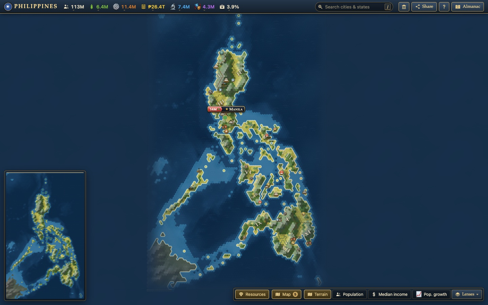
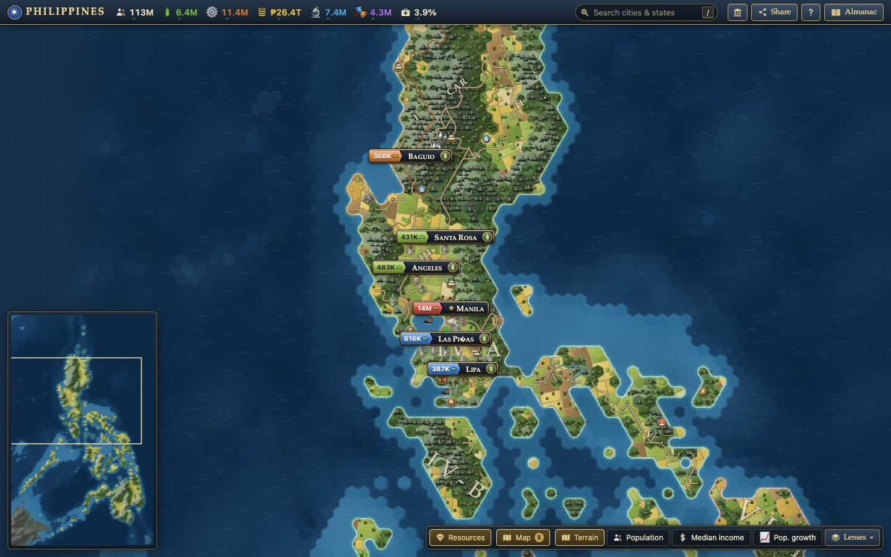
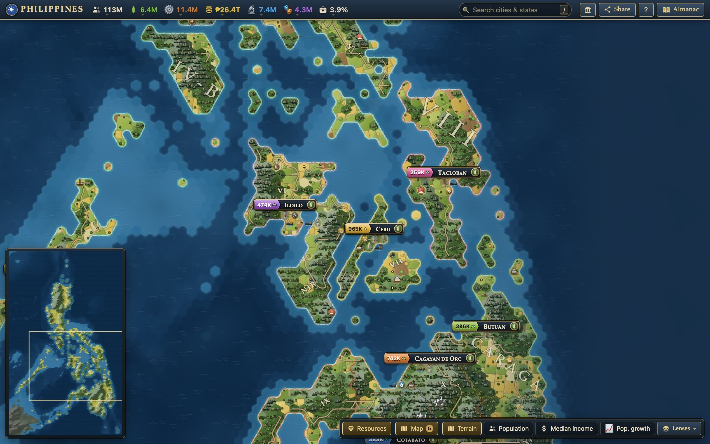
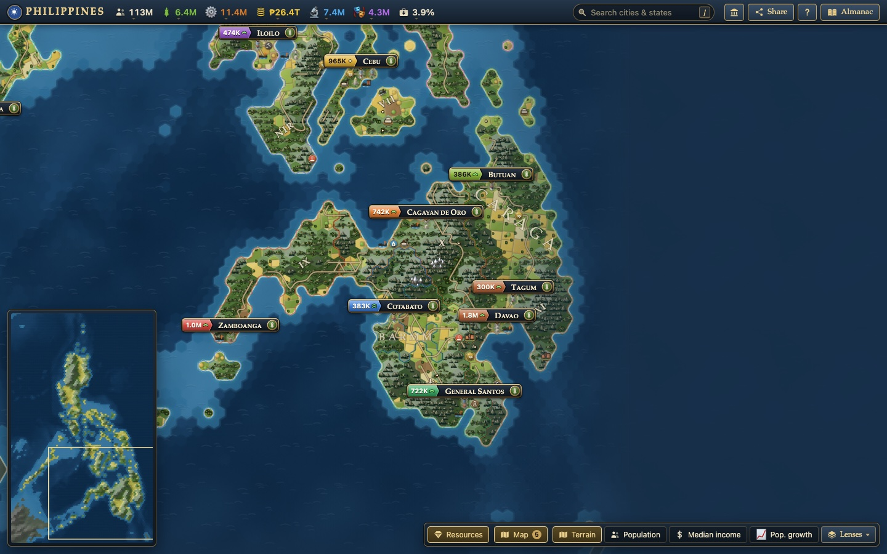
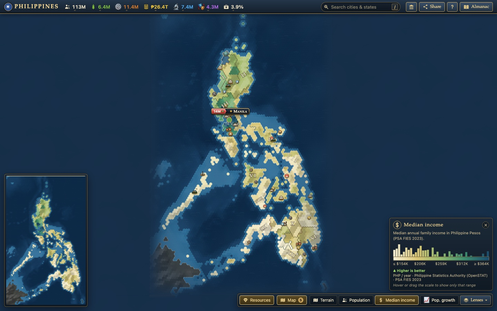

# rpciv: the Philippines as a strategy game, built from real data

**Live: [intuitionmachine.github.io/rpciv](https://intuitionmachine.github.io/rpciv/)** · Created by **[Intuition Machine, Inc.](https://intuitionmachine.com/)**



A visualizer (not a game) that draws the **real** Philippines like a turn-based strategy map. Hex terrain comes from
NOAA ETOPO1 elevation/bathymetry and PSA land classification. Cities have yield banners built from PSA GDP and workforce
data. Resources are real Philippine power plants (solar, coal, hydro, geothermal, natural gas, oil, wind, and biomass).
Highways, railways, seaports, airports, and wonders sit on the tiles. There are provincial lenses (including typhoons
and earthquakes since 1980), a City View, and a council of Advisors for slicing the data. Every number traces back to a
public source in the in-app **Almanac**.

It is a static site: plain ES modules and Canvas 2D, with no framework, no npm, and no build step. The data is built
by a small Python pipeline using only the standard library, from public downloads that need no API keys.

<table>
  <tr>
    <td></td>
    <td></td>
  </tr>
  <tr>
    <td></td>
    <td></td>
  </tr>
</table>

## What's in it

- **The map.** Painted 9 km hex terrain across the entire Philippine archipelago (80 × 149 hexes, 1,475 Philippine land
  hexes): tropical forests, rice and cropland plains, coastal wetlands, wooded hills, and mountain ranges (Cordillera,
  Sierra Madre, Mt. Apo, Mt. Kitanglad). Coasts and ocean depths are smoothed from ETOPO1, with neighboring territories
  (Taiwan, Sabah/Malaysia, Indonesia, Brunei) shown under a light fog. All art is drawn in code.
- **Yields.** The top bar and city banners show Food, Production, Gold, Science, and Culture. **Gold is GDP** in
  Philippine Pesos (`₱`) from PSA GRDP and Provincial Product Accounts. The other yields estimate workers by major
  sector from the PSA Labor Force Survey and sector GVA shares. Click any yield for a national leaderboard.
- **Tile improvements.** National highways (Natural Earth 1:10m), railways (PNR, LRT, MRT via HOT OSM), 18 principal
  seaports, and 55 commercial airports (OurAirports). Toggle them from the **Map** menu.
- **Energy & Resources.** 104 Philippine power plants (≥ 10 MW) from the WRI Global Power Plant Database / PH DOE:
  solar, coal, hydro, oil/diesel, geothermal, natural gas, wind, and biomass.
- **Wonders.** 19 wonders across the archipelago: UNESCO World Heritage Sites (Tubbataha, Puerto Princesa Subterranean
  River, Rice Terraces of the Cordilleras, Historic City of Vigan, Baroque Churches, Mt. Hamiguitan), iconic ENIPAS
  national parks (Mt. Apo, Mt. Pulag, Mayon, Chocolate Hills, Taal, Siargao, El Nido), and leading Philippine research
  universities.
- **Lenses.** Colour all 81 provinces plus Metro Manila by Population Density, Population Growth (2020–2024), Median
  Family Income, GDP per Capita, Poverty Incidence, Urbanization, Internet Use, **Typhoons since 1980** (NOAA IBTrACS),
  **Earthquakes M5+ since 1980** (USGS), and Forest Cover. The legend is an interactive histogram you can brush.
- **Advisors & Explorer.** Docked dashboards linked both ways with the map. The **Explorer** turns any column of
  regions, cities, or provinces into a sortable table and scatter plot that highlights your selection on the map.
- **Sharing and navigation.**
  - Every view has a shareable URL hash, and share images are rendered off-screen.
  - Search with `/`; press `?` for keyboard shortcuts.
  - Works on phones and tablets.

## Quick start

You need [uv](https://docs.astral.sh/uv/), which fetches Python 3.11+ automatically. Nothing else needs installing.

```bash
uv run python -m pipeline serve        # http://127.0.0.1:8765
```

The built Philippine data (`web/data/`, ~1.2 MB) is included, so that is all it takes to run locally. `web/` is a
self-contained static site (~3.7 MB total) deployed directly to GitHub Pages via
[.github/workflows/pages.yml](.github/workflows/pages.yml).

## Rebuilding the Philippine data

Raw Philippine datasets live in `data/philippines/` (git-ignored; see [docs/PHILIPPINES_DATA.md](docs/PHILIPPINES_DATA.md)
for the complete inventory and USA-to-Philippines source mapping). To rebuild all `web/data/*.json` files and validate
them against [docs/DATA_CONTRACTS.md](docs/DATA_CONTRACTS.md):

```bash
uv run python -m pipeline.ph_world
uv run python -m pipeline.ph_economy
uv run python -m pipeline.ph_layers
uv run python -m pipeline.ph_economy
uv run python -m pipeline check
```

## Architecture

```
pipeline/
  core/          shared plumbing: projection (geo.py, Albers centered on Philippines), hex grid (hexgrid.py),
                 atomic JSON IO (store.py), cached downloads with provenance manifests (fetch.py)
  ph_world.py    builds web/data/world.json (80×149 hex grid, regions, provinces, relief, land cover)
  ph_economy.py  builds states.json (18 regions), cities.json (55 cities), nation.json, counties.json (81 provinces), lenses.json
  ph_layers.py   builds resources.json (power plants), infrastructure.json (roads/rail/ports/airports), wonders.json, sources.json
  check.py       validates web/data against docs/DATA_CONTRACTS.md and prints a data-quality report
web/
  js/            main.js, camera, hex grid, render/ (Canvas 2D map & art), ui/ (panels, lenses, Almanac, minimap),
                 app/ (API, search, sharing, URL state), ext/ (City View, Advisors, map layers)
  data/          generated Philippine JSON loaded by the browser (~1.2 MB)
docs/
  DATA_CONTRACTS.md     JSON schemas shared by pipeline and browser
  PHILIPPINES_DATA.md   Philippine dataset inventory & provenance mapping
```

## Data sources

All 23 sources are public and require no API keys. Open the **Almanac** from the top bar for exact URLs, retrieval dates,
file sizes, and SHA-256 checksums.

| Source | Publisher | Used for |
|---|---|---|
| GADM 4.1 Philippines (ADM0, ADM1, ADM2) | GADM | Archipelago land outlines, 81 provinces, city/municipality centroids |
| Philippines COD-AB Administrative Hierarchy | OCHA / PSA / NAMRIA (HDX) | Official PSGC Region → Province → City/Municipality mapping |
| 2024 Census of Population (POPCEN-CBMS) | Philippine Statistics Authority (OpenSTAT) | Population, age/sex, 2010–2024 growth, land area, density, urbanization |
| 2020 Census of Population and Housing | Philippine Statistics Authority (OpenSTAT) | 2020 population baseline, housing tenure, religious affiliation |
| Gross Regional Domestic Product (GRDP, 2018–2025) | Philippine Statistics Authority (OpenSTAT) | Regional & national Gold yield (GDP in PHP) by major industry |
| Provincial Product Accounts (PPA, 2018–2025) | Philippine Statistics Authority (OpenSTAT) | Province & HUC GDP and GDP per capita lens |
| Family Income and Expenditure Survey (FIES 2023) | Philippine Statistics Authority (OpenSTAT) | Median & average family income, expenditure, Gini coefficient |
| Full Year Official Poverty Statistics (2023) | Philippine Statistics Authority (OpenSTAT) | Poverty incidence lens by Region, Province, and HUC |
| Labor Force Survey (LFS) | Philippine Statistics Authority (OpenSTAT) | Employment by industry (PSIC), occupation (PSOC), education, wages |
| Digital Connectivity (2024) | Philippine Statistics Authority (OpenSTAT) | Internet use lens by region |
| Status of Land Classification (2021) | Philippine Statistics Authority (OpenSTAT) | Provincial forestland vs. alienable & disposable land |
| Domestic Trade Statistics (Air, Coastwise, Road) | Philippine Statistics Authority (OpenSTAT) | Inter-regional commodity flows |
| ETOPO1 Global Relief Model | NOAA NCEI (via ERDDAP) | Elevation, hills/mountains/peaks, hill-shading, ocean depth |
| Natural Earth 1:50m and 1:10m (v5.1.2) | Natural Earth | Neighboring territories, lakes, rivers, national highways |
| Global Power Plant Database (Philippines) | World Resources Institute / PH DOE | 104 mapped power plants (solar, coal, hydro, geothermal, gas, oil, wind, biomass) |
| OurAirports Philippines | OurAirports | 55 commercial airports with IATA codes |
| HOT OSM Philippines (Ports, Railways, Health) | Humanitarian OpenStreetMap Team (HDX) | Seaports/RoRo terminals, railways (PNR/LRT/MRT), health facilities |
| IBTrACS Western North Pacific (v04r01) | NOAA NCEI | Typhoons lens (historical tracks in PAR since 1980) |
| USGS Earthquake Catalog | U.S. Geological Survey | Earthquakes lens (M ≥ 5.0 events since 1980) |
| UNESCO World Heritage List | UNESCO World Heritage Centre | World Heritage wonders in the Philippines |

## Credits and license

Created by **[Intuition Machine, Inc.](https://intuitionmachine.com/)**. Built on the open-source `usaciv` visualizer
engine (MIT-licensed; see [LICENSE](LICENSE)) and adapted for the Philippines (`rpciv`). The MIT license covers the code
only, not the underlying datasets, which remain under their respective publishers' open-data terms (PSA Open Data,
NOAA/USGS public domain, Natural Earth public domain, CC BY / ODbL).

The look is inspired by turn-based 4X strategy games, with all glyphs, icons, and textures drawn in code. This project
is not affiliated with or endorsed by any game publisher.
